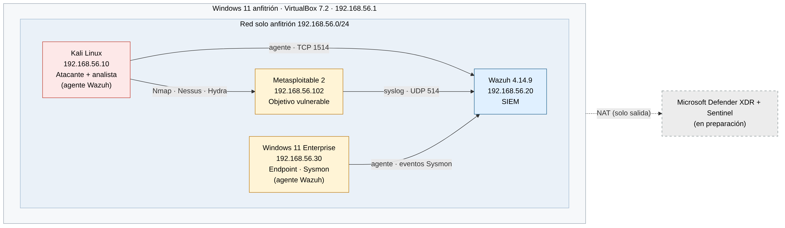
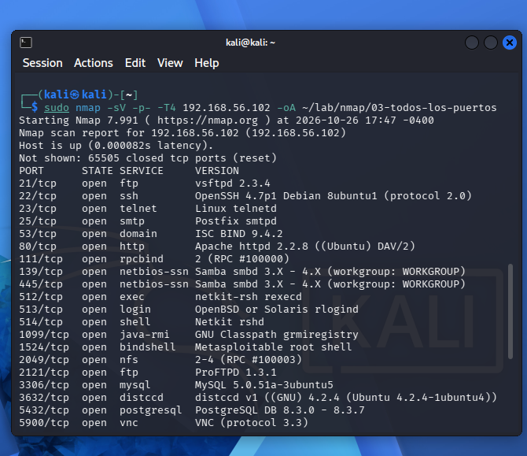
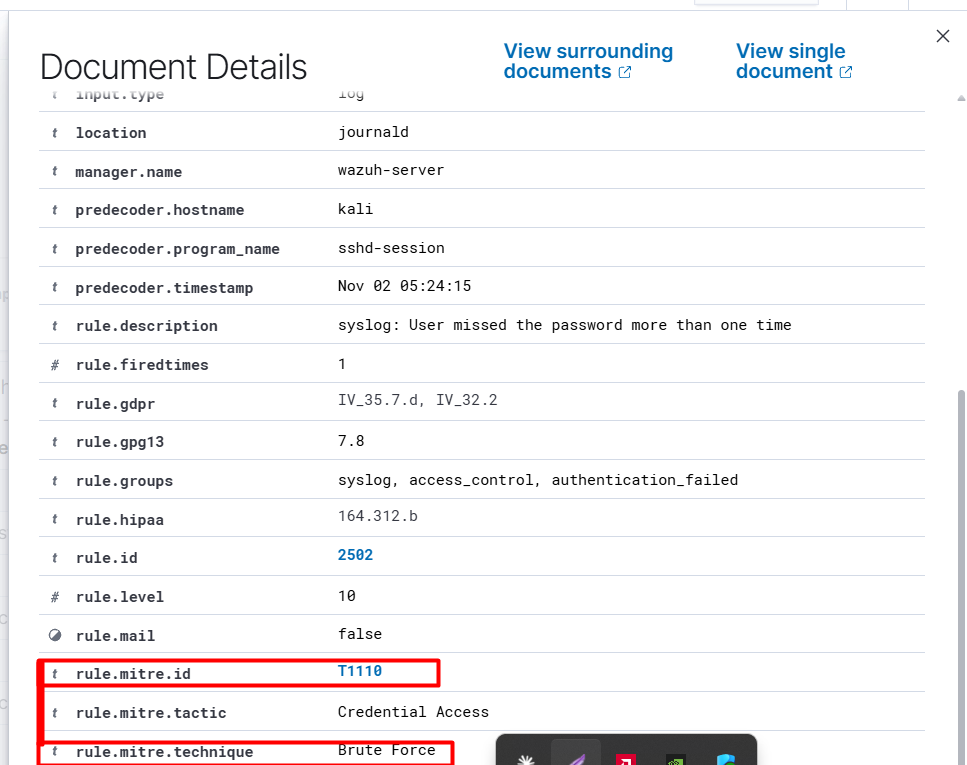
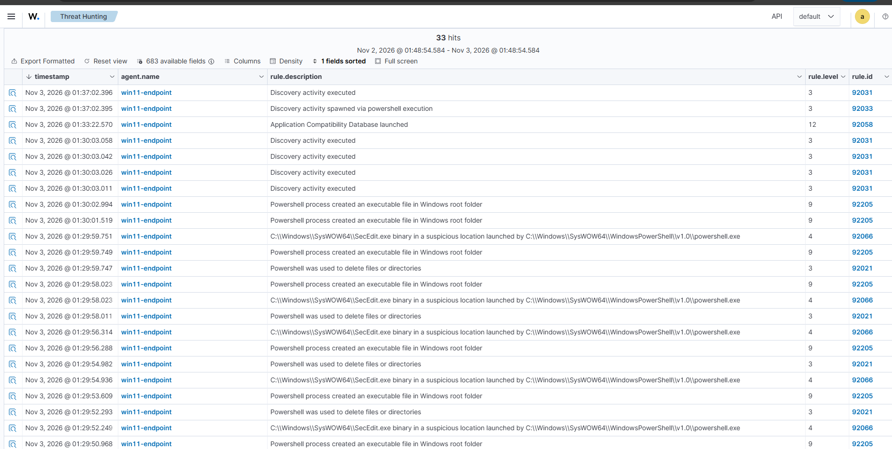
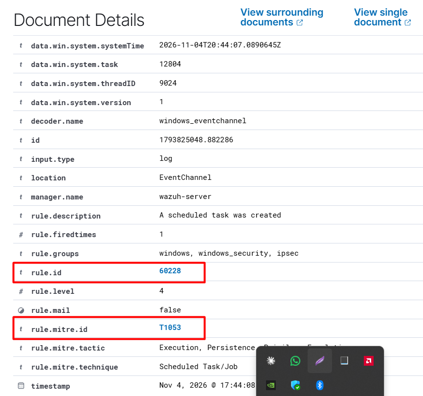

# SOC Home Lab


Laboratorio personal donde practico el trabajo de un **analista SOC Nivel 1**: descubrir activos, evaluar vulnerabilidades, centralizar la telemetría de equipos Linux y Windows en un SIEM, detectar ataques mapeados a MITRE ATT&CK e investigar alertas. Cada módulo deja evidencia (capturas, salidas crudas e informes) para que cualquiera pueda revisar lo que hice.

> **English summary:** Personal SOC Level 1 home lab. Kali Linux attacks an intentionally vulnerable target inside an isolated network; findings are assessed with Nmap and Nessus (CVSS + EPSS). Logs from Linux agents, syslog sources and a Windows 11 endpoint (Sysmon) are centralized in Wazuh SIEM to detect and investigate attacks mapped to MITRE ATT&CK. Next: Microsoft Defender XDR and Microsoft Sentinel (KQL), Atomic Red Team simulations and AI-assisted alert triage.

**Autor:** Mario Felipe Busqués Araya · Ingeniero en Informática orientado a ciberseguridad

---

## Qué demuestra este laboratorio

| Habilidad | Dónde se ve |
|---|---|
| Diseño de un entorno aislado y seguro | [Módulo 0](#módulo-0--infraestructura) · [`docs/alcance.md`](docs/alcance.md) |
| Reconocimiento de red con Nmap | [Módulo 1](#módulo-1--reconocimiento-con-nmap) |
| Gestión de vulnerabilidades con Nessus y priorización CVSS vs EPSS | [Módulo 1b](#módulo-1b--evaluación-de-vulnerabilidades-con-nessus) |
| Despliegue y troubleshooting de un SIEM (Wazuh), agentes y syslog | [Módulo 2](#módulo-2--siem-con-wazuh) |
| Telemetría de endpoint Windows con Sysmon | [Módulo 3](#módulo-3--endpoint-windows-con-sysmon) |
| Detección de ataques con mapeo MITRE ATT&CK | [Casos de detección](#casos-de-detección) |
| Triage de alertas con IA local y seguridad de IA (anonimización, prompt injection, evaluación honesta) | [Módulo 6](#módulo-6--triage-de-alertas-con-ia-local) · [`04-triage-ia`](04-triage-ia/README.md) |
| Investigación y triage de alertas (falso positivo documentado) | [`INV-001`](03-endpoint-windows/investigaciones/INV-001-sdbinst-falso-positivo.md) |

## Arquitectura



| Máquina | Rol | IP |
|---|---|---|
| Windows 11 (anfitrión) | VirtualBox 7.2 | 192.168.56.1 |
| Kali Linux | Atacante y analista (agente Wazuh) | 192.168.56.10 |
| Wazuh 4.14.9 | SIEM (manager, indexer y dashboard) | 192.168.56.20 |
| Windows 11 Enterprise (evaluación) | Endpoint con Sysmon y agente Wazuh | 192.168.56.30 |
| Metasploitable 2 | Objetivo vulnerable a propósito (envía logs por syslog) | 192.168.56.102 |

Red solo anfitrión `192.168.56.0/24`. La única excepción es el endpoint Windows, que tiene un segundo adaptador NAT de solo salida para los servicios en la nube de Microsoft. Reglas del laboratorio en [`docs/alcance.md`](docs/alcance.md).

## Avance

| Módulo | Contenido | Estado |
|---|---|---|
| 0 · Infraestructura | VirtualBox, red aislada, IPs fijas, instantáneas | ✅ |
| 1 · Reconocimiento | Nmap: hosts, servicios y los 65.535 puertos | ✅ |
| 1b · Vulnerabilidades | Nessus Essentials, CVSS v3 y EPSS | ✅ |
| 2 · SIEM | Wazuh, agente Linux, syslog, detección de fuerza bruta | ✅ |
| 3 · Endpoint Windows | Windows 11, Sysmon, agente Wazuh, investigación de alertas | ✅ |
| 4 · Microsoft | Defender for Endpoint y Microsoft Sentinel, reglas propias en KQL | ⏳ |
| 5 · Simulación de ataques | Atomic Red Team y simulaciones manuales mapeadas a MITRE ATT&CK (3 técnicas) y primera regla propia | ✅ |
| 6 · Triage con IA | Script en Python con IA local (Ollama) que resume y clasifica alertas, con defensas contra prompt injection y decisión humana | ✅ |
| 7 · Informes | Informes de incidente NIST 800-61 y capa de MITRE Navigator | ⏳ |

---

## Módulo 0 · Infraestructura

Máquinas virtuales en una red solo anfitrión, con IP fija en Kali, Metasploitable aislada y una instantánea limpia de cada VM antes de empezar.

Evidencia: [`00-infraestructura/capturas/`](00-infraestructura/capturas/)

## Módulo 1 · Reconocimiento con Nmap

**Objetivo:** descubrir activos e identificar los servicios expuestos del objetivo.

1. Descubrimiento de hosts en la red (`nmap -sn`).
2. Servicios y versiones en los 1.000 puertos más comunes (`nmap -sV`).
3. Servicios en los 65.535 puertos (`nmap -sV -p- -T4`).

**Resultado:** 30 puertos abiertos agrupados en 9 hallazgos. El escaneo completo encontró el puerto **1524 (bind shell como root)**, que el escaneo de puertos comunes no detectó: por eso nunca hay que quedarse solo con los puertos por defecto.



- Comandos explicados: [`01-vulnerabilidades/comandos.md`](01-vulnerabilidades/comandos.md)
- Salida cruda (`.nmap`, `.gnmap`, `.xml`): [`01-vulnerabilidades/evidencias/`](01-vulnerabilidades/evidencias/)
- Informe: [`Informe_Nmap_Metasploitable.xlsx`](01-vulnerabilidades/informes/Informe_Nmap_Metasploitable.xlsx)

## Módulo 1b · Evaluación de vulnerabilidades con Nessus

**Objetivo:** pasar de "qué está expuesto" a "qué tan grave es" y priorizar.

Nessus Essentials 10.12.6, plantilla *Basic Network Scan*, sin credenciales, severidad en CVSS v3.0.

| Crítica | Alta | Media | Baja | Informativa | Total |
|:-:|:-:|:-:|:-:|:-:|:-:|
| 9 | 6 | 24 | 8 | 134 | 181 |

**Hallazgos clave**

- **Confirmados:** bind shell en el puerto 1524 (CVSS 9.8) y Ubuntu 8.04 sin soporte (CVSS 10.0).
- **Reclasificado:** Tomcat AJP (*Ghostcat*) estaba como Baja con Nmap y es **Crítica** (CVSS 9.8, EPSS 0.99).
- **Solo los vio Nessus:** VNC con contraseña `password`, SSL v2/v3, DROWN y Logjam.
- **Discrepancias a verificar:** Nessus no marcó la puerta trasera de vsftpd 2.3.4, UnrealIRCd ni distccd, que sí aparecen con Nmap. Un escaneo sin credenciales no prueba que algo sea seguro.

**Lección: CVSS no basta para priorizar.** Logjam tiene CVSS 3.7 (baja) pero EPSS 0.9986, la probabilidad de explotación más alta del escaneo. Por eso el informe cruza ambas métricas.

- Informe con comparación Nmap vs Nessus y priorización: [`Informe_Nessus_Metasploitable.xlsx`](01-vulnerabilidades/informes/Informe_Nessus_Metasploitable.xlsx)
- Evidencia de los 69 plugins: [`Nessus_M1b_Evidencia_Vulnerabilidades.pdf`](01-vulnerabilidades/evidencias/Nessus_M1b_Evidencia_Vulnerabilidades.pdf)

## Módulo 2 · SIEM con Wazuh

**Objetivo:** centralizar logs de distintos tipos de fuente y detectar ataques reales.

- **Servidor:** Wazuh 4.14.9 (OVA oficial) con IP fija `192.168.56.20` y disco ampliado a 80 GB.
- **Fuente con agente:** Kali Linux (`kali-atacante`), versión del agente igual a la del servidor.
- **Fuente sin agente:** Metasploitable 2 es demasiado antigua para el agente, así que reenvía su syslog por UDP 514. Wazuh solo acepta ese tráfico de `192.168.56.102` (`allowed-ips`).



Evidencia: [`02-siem-wazuh/capturas/`](02-siem-wazuh/capturas/) · [`02-siem-wazuh/evidencias/`](02-siem-wazuh/evidencias/)

## Módulo 3 · Endpoint Windows con Sysmon

**Objetivo:** obtener telemetría de un endpoint Windows como la que usa un SOC real.

- Windows 11 Enterprise (evaluación) con TPM 2.0 y Secure Boot, IP fija `192.168.56.30`.
- **Sysmon** (firma de Microsoft verificada) con la configuración de la comunidad SwiftOnSecurity.
- **Agente de Wazuh 4.14.9** (firma verificada) leyendo el canal `Microsoft-Windows-Sysmon/Operational`.



Evidencia: [`03-endpoint-windows/capturas/`](03-endpoint-windows/capturas/) · Investigación: [`INV-001`](03-endpoint-windows/investigaciones/INV-001-sdbinst-falso-positivo.md)

## Módulo 5 · Simulación de ataques con Atomic Red Team

**Objetivo:** ejecutar técnicas reales de MITRE ATT&CK en mi propio endpoint y comprobar si el SIEM las detecta, y con qué calidad.

Se usa [Atomic Red Team](https://github.com/redcanaryco/atomic-red-team) con el módulo Invoke-AtomicRedTeam, solo en la máquina virtual de Windows 11. Cada prueba se lee antes de ejecutarla (`-ShowDetails`), se ejecuta, se analiza en Wazuh y se limpia. Cuando no existe una prueba lista, la técnica se simula a mano y el informe lo indica.

| Caso | Técnica | Resultado | Informe |
|---|---|---|---|
| 5 | T1136.001 · Cuenta local creada (Persistence) | Detectado por Sysmon (regla 92040, nivel 12) y por el registro de Seguridad (60109, 60110) | [ATOMIC-001](03-endpoint-windows/atomic-red-team/ATOMIC-001-T1136.001-cuenta-local.md) |
| 6 | T1053.005 · Tarea programada (Persistence) | Primera vez: Windows no registró el evento 4698. Tras activar la auditoría: detectado (92032 + 60228) | [ATOMIC-002](03-endpoint-windows/atomic-red-team/ATOMIC-002-T1053.005-tarea-programada.md) |
| 7 | T1070.001 · Borrado de registros de eventos (Defense Evasion), simulación manual | Aviso genérico de Windows (63103, nivel 5); el comando no estaba cubierto. **Regla propia 100100** (nivel 12) | [ATOMIC-003](03-endpoint-windows/atomic-red-team/ATOMIC-003-T1070.001-borrado-registros.md) · [regla](reglas-wazuh/100100-wevtutil-borrado-registros.xml) |



---

## Casos de detección

| # | Ataque o actividad | Origen → Destino | Regla(s) de Wazuh | MITRE ATT&CK | Evidencia |
|---|---|---|---|---|---|
| 1 | Fallos de login SSH repetidos | Windows anfitrión → Kali (agente) | 5760, 5557, 5503 y **2502** (nivel 10) | T1110 Brute Force (Credential Access) | [27c](02-siem-wazuh/capturas/27c-m2-wazuh-detalle-alerta-mitre.png) |
| 2 | Fuerza bruta SSH con Hydra | Kali → Metasploitable (syslog) | 2501 (x4, nivel 5) | T1110.001 Password Guessing | [30](02-siem-wazuh/capturas/30-m2-hydra-fuerza-bruta-exito.png) · [31](02-siem-wazuh/capturas/31-m2-hydra-alertas-wazuh.png) · [31b](02-siem-wazuh/capturas/31b-m2-hydra-detalle-regla-2501.png) |
| 3 | Reconocimiento del equipo (`whoami /all`, `ipconfig /all`, `net user`) | Endpoint Windows | 92031, 92033 (nivel 3) | Táctica Discovery | [46](03-endpoint-windows/capturas/46-m3-wazuh-eventos-sysmon.png) · [47](03-endpoint-windows/capturas/47-m3-wazuh-sysmon-detalle-comando.png) |
| 4 | Alerta de nivel 12 sin causa aparente | Endpoint Windows | 92058 (nivel 12) | T1546.011 Application Shimming | [INV-001](03-endpoint-windows/investigaciones/INV-001-sdbinst-falso-positivo.md): **falso positivo** |
| 5 | Creación de cuenta local (`net user /add`) | Atomic Red Team → Endpoint Windows | **92040** (nivel 12), 60109, 60110 | T1136.001 Local Account (Persistence) | [ATOMIC-001](03-endpoint-windows/atomic-red-team/ATOMIC-001-T1136.001-cuenta-local.md) |
| 6 | Tarea programada para persistencia (`schtasks /Create`) | Atomic Red Team → Endpoint Windows | 92032 (nivel 3), **60228** (nivel 4) | T1053 Scheduled Task/Job (Execution, Persistence, Privilege Escalation) | [ATOMIC-002](03-endpoint-windows/atomic-red-team/ATOMIC-002-T1053.005-tarea-programada.md) |
| 7 | Borrado de registros de eventos (`wevtutil cl`) | Simulación manual → Endpoint Windows | 63103 (nivel 5) y **100100, regla propia** (nivel 12) | T1070.001 Clear Windows Event Logs (Defense Evasion) | [ATOMIC-003](03-endpoint-windows/atomic-red-team/ATOMIC-003-T1070.001-borrado-registros.md) |

**Hallazgos de analista**

- **Brecha de detección (caso 2):** la ráfaga rápida de Hydra disparó la regla base 2501, pero no la regla de correlación 2502 que sí se activó con intentos manuales más lentos. Además, 2501 no trae mapeo a MITRE. Un SIEM con reglas de fábrica no cubre todos los ritmos de ataque: hace falta afinar o escribir reglas propias.
- **Brecha de visibilidad corregida (caso 6):** Windows no registraba la creación de tareas programadas (evento 4698) porque la auditoría *Other Object Access Events* estaba desactivada. Se activó con `auditpol`, se repitió la prueba y Wazuh generó la alerta 60228. La detección dependía de la configuración del endpoint, no del SIEM.
- **Correlación de fuentes (casos 5 y 6):** cada ataque se confirma con Sysmon (el comando y la cadena de procesos) y con el registro de Seguridad de Windows (el resultado). En el caso 6 ambos eventos están separados por 63 milisegundos.
- **Brecha cerrada con regla propia (caso 7):** Sysmon registraba `wevtutil cl`, pero ninguna regla de fábrica lo interpretaba; solo existía el aviso genérico de Windows (evento 1102, nivel 5) y únicamente para el registro de Seguridad. Se escribió la regla 100100 sobre el comando, se validó con `wazuh-analysisd -t` y se comprobó que dispara con nivel 12 y MITRE T1070.001.
- **Desfase de reloj (caso 7):** entre el servidor Wazuh y el endpoint hubo diferencias de entre 1 y 6 minutos en las marcas de tiempo. En un SOC real se sincroniza con NTP, porque un desfase estropea la correlación.
- **Mapeo MITRE impreciso (caso 6):** la regla 92032 mapea también a T1087 (descubrimiento de cuentas), que no describe una tarea programada, y la 60228 mapea a la técnica padre T1053. La técnica exacta la decide el analista leyendo el comando.
- **Falso positivo documentado (caso 4):** una alerta de nivel 12 resultó ser mantenimiento normal de Windows. Se descartó con evidencia: ruta legítima, binario de Microsoft sin renombrar, proceso padre `PcaSvc` y ausencia de archivo `.sdb`.

## Módulo 6 · Triage de alertas con IA local

**Objetivo:** reducir el tiempo de lectura de una alerta con un modelo de IA **local** (Ollama, `llama3.2:3b`), sin que los datos salgan del equipo y sin que la IA tome decisiones. Detalle completo: [`04-triage-ia/README.md`](04-triage-ia/README.md).

| Defensa | Qué hace |
|---|---|
| Solo localhost | El script rechaza cualquier destino que no sea local |
| Anonimización | Oculta contraseñas y reemplaza usuarios, equipos, IP y SID antes de consultar al modelo |
| Anti prompt injection | Detecta y omite texto del atacante dirigido a la IA y escala la alerta como indicador hostil |
| Salida validada | Esquema JSON y validación de cada campo |
| Política asimétrica | Un falso positivo en alerta de nivel 12 o más exige confianza ALTA; si no, revisión humana |
| Sin acciones automáticas | La decisión queda `PENDIENTE` para el analista |

**Resultados (5 alertas, 3 ejecuciones):** la v1 respondió `NO_CONCLUYENTE` a todo. Al pedirle al modelo que **razone antes de decidir**, acertó los casos claros (3 de 5), pero marcó un falso positivo como ataque en una corrida y no reconoció el borrado de registros. La misma configuración dio resultados distintos entre corridas. En ninguna ejecución se descartó un ataque real. Sin defensas, el modelo repitió el texto de la alerta trampa; con defensas, la inyección se detectó y se escaló.

Conclusión: un modelo de 3B sirve como apoyo de lectura, no como juez. Evidencia: [`04-triage-ia/resultados/`](04-triage-ia/resultados/) · [capturas 75-84](04-triage-ia/capturas/).

---

## Problemas que resolví

| Problema | Causa | Solución |
|---|---|---|
| El panel de Wazuh no cargaba (índices en solo lectura) | El OVA trae un disco de 25 GB y el detector de vulnerabilidades lo llenó al 100% en el primer arranque | Reimportar, ampliar el disco a 80 GB antes de encender y crecer la partición con `growpart` y `xfs_growfs` |
| La IP de Wazuh podía cambiar | Estaba por DHCP | IP fija con `systemd-networkd`, con respaldo del archivo original |
| Wazuh no escuchaba syslog tras editar la configuración | `systemctl restart` no recargó `wazuh-remoted` | Reinicio con `wazuh-control restart` y verificación del puerto con `ss -ulnp` |
| Hydra y SSH fallaban contra Metasploitable | Su servidor SSH de 2008 solo ofrece algoritmos antiguos | Bloque específico para esa IP en `ssh_config` de Kali, sin debilitar el resto |
| El panel de Wazuh mostraba "Algo salió mal" | La traducción automática de Chrome rompe la interfaz React | Desactivar la traducción para ese sitio |
| La VM de Windows empezó a reinstalarse sola | Seguía conectado el disco de la instalación desatendida | Quitar la unidad óptica y restaurar la instantánea limpia |
| Windows Defender bloqueó el instalador de Atomic Red Team | AMSI detecta el script de instalación como malicioso | Excluir solo la carpeta `C:\AtomicRedTeam` y descargar manualmente únicamente las definiciones necesarias |
| La descarga de las pruebas tardaba más de 15 minutos | `Invoke-WebRequest` en PowerShell 5.1 es muy lento con la barra de progreso activa | Desactivar la barra (`$ProgressPreference='SilentlyContinue'`) y bajar solo los archivos de las técnicas usadas |
| No existía el archivo de Atomic Red Team para T1070.001 (404 dos veces) | La ruta estándar del repositorio no contiene esa técnica | Simulación manual con `wevtutil`, indicada como tal en el informe |
| No se podía copiar y pegar comandos en la VM de Windows | Sin portapapeles compartido entre el anfitrión y la VM | Conexión SSH al servidor Wazuh desde el anfitrión, donde sí se pega |
| No aparecía el evento de tarea programada (4698) | La auditoría de Windows para ese evento estaba desactivada | Activar la subcategoría con `auditpol` y repetir la prueba |
| La búsqueda de Wazuh no encontraba `schtasks` | Los filtros distinguen mayúsculas y el comando se registró como `SCHTASKS` | Buscar por la imagen (`data.win.eventdata.image:*schtasks.exe`) |
| Nessus Essentials no permite exportar informes | Limitación de la licencia gratuita | Capturas de la vista completa y armado de un PDF de evidencia |
| El hash del instalador de Nessus no coincidía al pegarlo | El texto copiado venía corrupto | Verificación por captura de pantalla contra el hash oficial |
| La IA local respondía `NO_CONCLUYENTE` a todas las alertas | El esquema pedía el veredicto antes del razonamiento y el prompt empujaba a la cautela | Campo `razonamiento` primero y prompt equilibrado; se conservan los resultados de la v1 como evidencia |
| La evaluación de la IA daba resultados distintos entre corridas | Los modelos locales no son totalmente deterministas aunque la temperatura sea 0 y la semilla fija | Documentarlo, no confiar en una sola corrida y mantener la política de seguridad y la revisión humana |
| `python` no se encontraba en Windows | El alias de la Tienda de Windows ocupaba el comando | Instalar Python con el administrador oficial y usar `py` |
| Se subió a GitHub un archivo `__pycache__` | Python lo genera al importar módulos | Quitarlo del repositorio y agregar `.gitignore` |

## Próximos pasos

1. **Más técnicas con Atomic Red Team** (otras variantes de persistencia y de evasión de defensas) y más reglas propias de Wazuh para las brechas encontradas.
2. **Microsoft Defender for Endpoint y Microsoft Sentinel** con el mismo endpoint, y reglas de detección propias en KQL.
3. ~~Triage asistido por IA~~ (hecho, módulo 6). Siguiente en esa línea: probar un modelo más grande y medir la repetibilidad con varias corridas.
4. **Informes de incidente** en formato NIST 800-61 y capa de MITRE ATT&CK Navigator.

## Estructura del repositorio

```text
soc-home-lab/
├── docs/                       alcance y topología
├── reglas-wazuh/               reglas propias de detección (XML)
├── 00-infraestructura/
│   └── capturas/
├── 01-vulnerabilidades/
│   ├── comandos.md             comandos explicados
│   ├── capturas/
│   ├── evidencias/             salida cruda de Nmap y PDF de Nessus
│   └── informes/               informes en Excel
├── 02-siem-wazuh/
│   ├── capturas/
│   └── evidencias/             reporte del agente en PDF
├── 03-endpoint-windows/
│   ├── capturas/
│   ├── investigaciones/        INV-001: alerta investigada
│   └── atomic-red-team/        ATOMIC-001, 002 y 003: técnicas simuladas y detectadas
└── 04-triage-ia/
    ├── triage.py               triage de alertas con IA local
    ├── evaluar.py              evaluación con alertas conocidas y alerta trampa
    ├── alertas/                alertas de Wazuh en JSON
    ├── resultados/             evaluaciones v1, v2 y última
    └── capturas/
```

## Aviso ético

Todo se ejecuta en máquinas propias, dentro de una red aislada creada para este fin. No uses estas técnicas contra sistemas sin autorización.
