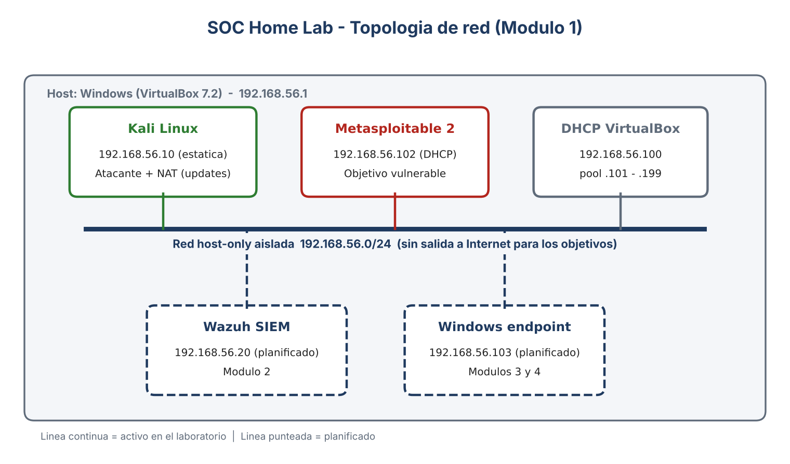

@'

\# SOC Home Lab

Laboratorio personal de ciberseguridad para practicar el trabajo de un \*\*analista SOC Nivel 1\*\*: gestión de vulnerabilidades, monitoreo con SIEM y detección de ataques. Cada módulo deja evidencia reproducible y un informe al estilo profesional.

\*\*Autor:\*\* Mario Felipe Busqués Araya, Ingeniero Informático orientado a ciberseguridad.

\## Entorno

| Componente | Detalle |

|---|---|

| Virtualización | VirtualBox 7.2 |

| Red | Host-only aislada `192.168.56.0/24` (sin salida a Internet para los objetivos) |

| Atacante / analista | Kali Linux (`192.168.56.10`, IP estática) |

| Objetivo | Metasploitable 2 (`192.168.56.102`), máquina vulnerable a propósito |

Las reglas y límites del laboratorio están en \[`docs/alcance.md`](docs/alcance.md).

\## Módulo 1: Gestión de vulnerabilidades

\*\*Objetivo:\*\* descubrir activos, identificar servicios expuestos y priorizar riesgos.

\*\*Qué hice\*\*

1\. Descubrimiento de hosts en la red del laboratorio (`nmap -sn`).

2\. Detección de servicios y versiones sobre el objetivo (`nmap -sV`).

3\. Escaneo de los 65.535 puertos (`nmap -p-`) para no depender de los puertos comunes.

4\. Análisis de resultados y clasificación por severidad.

\*\*Resultado:\*\* 30 puertos abiertos agrupados en 9 hallazgos.

| Severidad | Hallazgos |

|---|---|

| Crítica | 3 (backdoor en puerto 1524, vsftpd 2.3.4, UnrealIRCd) |

| Alta | 3 (Telnet y servicios r-\*, distccd, software obsoleto) |

| Media | 2 (bases de datos expuestas, SMB/NFS/RPC) |

| Baja | 1 (Tomcat/AJP) |

> Las severidades son preliminares, estimadas por criterio propio. Se recalibrarán con puntaje CVSS cuando se escanee con Nessus.

\*\*Contenido\*\*

\- \[`01-vulnerabilidades/evidencias/`](01-vulnerabilidades/evidencias/): salida cruda de Nmap (`.nmap`, `.gnmap`, `.xml`).

\- \[`01-vulnerabilidades/informes/`](01-vulnerabilidades/informes/): informe en Excel con resumen ejecutivo, inventario de puertos y hallazgos con remediación.

\## Hoja de ruta

\- \[x] Módulo 1: reconocimiento y escaneo con Nmap

\- \[ ] Módulo 1b: escaneo con Nessus Essentials, CVSS y rescan tras remediar

\- \[ ] Módulo 2: SIEM con Wazuh

\- \[ ] Módulo 3: Active Directory y endpoint Windows

\- \[ ] Módulo 4: simulación de ataques y detección mapeada a MITRE ATT\&CK

\- \[ ] Módulo 5: reportes de incidentes, reglas personalizadas y dashboard

\## Aviso

Todo se ejecuta en máquinas propias, en una red aislada y creada para este fin. No escanear ni atacar sistemas ajenos.

'@ | Out-File -Encoding utf8 README.md

